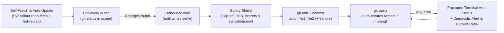

<div align="center">


# S Y N C A L I B U R

**Autonomous Cross-Platform Git Auto-Sync Daemon**

*Zero-friction background Git synchronization across Linux, macOS, and Windows — featuring a 2×2 subpixel TrueColor terminal emblem, multi-remote & identity auto-detection, automatic remote repository creation, self-watching & upstream hot-reload auto-updater, pre-staging secret/size guards, and proactive failure terminal alerts.*

[](#3-how-auto-start-works-across-operating-systems)
[](#)
[](#4-automatic-remote-repository-creation--self-update-engine)
[](#5-built-in-safety-shield--proactive-failure-alerts)

</div>

---

## ◈ Highlights

- **◈ 2×2 Subpixel TrueColor Terminal Emblem & Dashboard:** Renders the official Syncalibur PNG emblem directly inside your terminal (`status`, `logs`, `alert`, `install`, `run`) using 2×2 subpixel Unicode quadrant partitioning (`▘ ▝ ▀ ▖ ▌ ▞ ▛ ▗ ▚ ▐ ▜ ▄ ▙ ▟ █`) alongside a real-time telemetry panel and color-coded activity badges.
- **🎯 Multi-Remote & Authorized Identity Detection:** Automatically inspects your Git configuration, SSH keys, and CLI credentials (`gh`, `glab`, tokens, SSH handshakes) to display every push destination (e.g. **GitHub** + **GitLab** dual-push) and your verified provider accounts (`@username`).
- **🔄 Self-Watching & Automatic Upstream Hot-Reload (`sync_and_update_self_repo`):**
  - Syncalibur automatically watches its own installation repository (`Syncalibur`) in the background!
  - Local improvements you make inside Syncalibur are automatically committed and pushed (while `syncalibur.env` stays gitignored and never leaves your machine).
  - Periodically fetches upstream updates (`every 120s`), pulls new releases (`git pull --rebase --autostash`), and **hot-reloads** the running daemon in-place (`exec`) without dropping a single cycle.
- **✦ Zero-Friction Bootstrap & Auto-Remote Creation:**
  - Ships with [`syncalibur.env.example`](syncalibur.env.example) and automatically creates your local gitignored `syncalibur.env` on first run.
  - If the watched folder is not a Git repository yet, Syncalibur initializes it automatically (`git init -b main`).
  - If the remote repository does not exist yet on **GitHub** or **GitLab** and your machine is authorized, Syncalibur creates the remote repository automatically and pushes.
- **🚨 Proactive "Sync Failed" Terminal Popup & Status View:** If a background commit, push, or self-update fails, Syncalibur automatically pops open a dedicated terminal window (`gnome-terminal`, `konsole`, `xfce4-terminal`, `kitty`, `alacritty`, macOS `Terminal.app`, Windows Git Bash) displaying the full **Syncalibur Status Dashboard + Diagnostic Report** with the exact error, root-cause hint, and one-key recovery (`[R]` retry / `[L]` live logs).
- **🌍 Native Cross-Platform Auto-Start:** Registers a native background service (`systemd` / `cron` on Linux, `launchd` `LaunchAgents` on macOS, hidden Startup VBS launcher on Windows Git Bash) so it starts silently on every boot/login.
- **🛡️ Pre-Staging Safety Shield:** Blocks oversized binaries (`> 50 MiB`, e.g. `.terraform/` providers) and sensitive secret files (`syncalibur.env`, `*.tfstate`, `.env`, `*.pem`, `*.key`, `id_rsa*`, `kubeconfig`) **before** `git add` so they never pollute `.git/objects` or break remote pushes.

---

## 🖥️ Terminal UI & Telemetry Preview

<div align="center">
  
</div>

Running `./syncalibur.sh status` or `./syncalibur.sh logs` renders the 2×2 subpixel TrueColor Syncalibur emblem alongside your detected push targets, verified accounts, and self-updater state:

```text
  ╭──────────────────────────────────────────────────────────────────────╮
  │   S Y N C A L I B U R   •   Autonomous Git Auto-Sync Daemon          │
  ╰──────────────────────────────────────────────────────────────────────╯
    ◈ Status    : ● ONLINE (PID 46305)
    ◈ OS / Mode : Linux (systemd)  •  ✔ Enabled (syncalibur • systemd)
    ◈ Author    : YusufKaya00 <144667540+YusufKaya00@users.noreply.github.com> (ysf@Ysf)
    ◈ Verified  : ✔ GitHub: @YusufKaya00 (gh+SSH)  •  ✔ GitLab: @YusufKaya00 (SSH)
    ◈ Watching  : ~/k8sfundamentals (scope: .)
    ◈ Config    : ~/Syncalibur/syncalibur.env (gitignored)
    ◈ Remote    : all (2 target(s) • branch 'main')
    ◈ Push #1   : GitHub → YusufKaya00/k8sfundamentals [main • SSH]
    ◈ Push #2   : GitLab → ysf-group1074641/Ysf-project [main • SSH]
    ◈ Self-Sync : ✔ Watching & Auto-Updating (~/Syncalibur @ main • every 120s)
    ◈ Automation: ✔ Auto-Repo (private)  •  ✔ Failure Terminal Popup ON
    ◈ Sync State: ✔ 0 unpushed commits (in sync)
    ◈ Shield    : Poll 3s • Debounce 5s • ≤ 50 MiB & Secret Guard
    ──────────────────────────────────────────────────────────────────────
    Commands  : status | logs | alert | restart | stop | install | uninstall
```

---

## 🚀 1. Quick Start (3 Steps on Any OS)

### Step 1 — Clone Syncalibur

```bash
git clone https://github.com/YusufKaya00/Syncalibur.git
cd Syncalibur
chmod +x syncalibur.sh
```

### Step 2 — Install & point to any directory you want to auto-sync

Pass the target directory path directly to `install` (this automatically creates your local, gitignored `syncalibur.env` from `syncalibur.env.example` so your personal path is never pushed):

```bash
./syncalibur.sh install /path/to/your/project
```

- If `/path/to/your/project` is not a Git repository yet, Syncalibur runs `git init -b main` automatically.
- If no remote repository exists yet, Syncalibur creates it under your authenticated GitHub/GitLab account on the first push.

### Step 3 — Inspect status, live logs, or failure alerts

```bash
# Render the Syncalibur emblem, detected push targets, verified accounts & recent logs
./syncalibur.sh status

# Stream live colorized telemetry
./syncalibur.sh logs

# Preview the full Status + "SYNC FAILED" diagnostic alert screen
./syncalibur.sh alert --test
```

---

## 📦 2. Repository Structure

```text
Syncalibur/
├── syncalibur.sh               # Main daemon, 2x2 subpixel TUI, self-updater & alert engine
├── syncalibur.env.example      # Public configuration template (copied to gitignored syncalibur.env)
├── assets/
│   ├── syncalibur-logo.png     # Official Syncalibur emblem (512x512 RGBA)
│   ├── syncalibur-logo.ansi    # Pre-rendered 2x2 subpixel TrueColor ANSI terminal emblem
│   └── syncalibur-terminal.png # High-DPI preview of the terminal dashboard
└── README.md                   # Documentation
```

---

## 🌍 3. How Auto-Start Works Across Operating Systems

`./syncalibur.sh install` automatically detects your operating system and registers a native startup service:

| Operating System | Auto-Start Mechanism Created by `install` | Behavior on Boot / Login |
| --- | --- | --- |
| **Linux (systemd)** | `~/.config/systemd/user/syncalibur.service` + `loginctl enable-linger` | Starts automatically on boot/login; systemd restarts it within 5s if it ever crashes |
| **Linux (no systemd / WSL)** | `crontab` `@reboot` entry + `~/.config/autostart/syncalibur.desktop` | Starts automatically in the background when the session/WSL starts |
| **macOS** | `~/Library/LaunchAgents/com.syncalibur.syncalibur.plist` (`RunAtLoad` + `KeepAlive`) | Starts automatically at macOS login; `launchd` keeps it alive at all times |
| **Windows (Git Bash / MSYS2)** | `%APPDATA%\Microsoft\Windows\Start Menu\Programs\Startup\syncalibur.vbs` | Launches `syncalibur.sh` silently at Windows login with no console window popup |

---

## ✦ 4. Automatic Remote Repository Creation & Self-Update Engine

When Syncalibur starts or runs in the background:

1. **Self-Watching & Upstream Auto-Update (`sync_and_update_self_repo`):**
   - Watches the `Syncalibur` directory itself for local code/doc improvements and auto-pushes them (excluding `syncalibur.env`).
   - Checks `origin/main` every `SYNCALIBUR_SELF_CHECK_INTERVAL` seconds (`120s` default). Whenever you push an update to the Syncalibur repository from anywhere, running instances automatically `git pull --rebase --autostash` and hot-reload (`exec`) in the background!
2. **Identity & Provider Probing (`probe_provider_auth`):**
   - **GitHub:** Checks `gh auth status`, `GH_TOKEN` / `GITHUB_TOKEN`, or `ssh -T git@github.com`.
   - **GitLab:** Checks `glab auth status`, `GITLAB_TOKEN`, or `ssh -T git@gitlab.com`.
3. **Automatic Remote Provisioning (`auto_create_or_bind_remote`):**
   - If the watched repository has no `origin` remote or the remote returns `Repository not found`, Syncalibur automatically creates the repository (`private` by default) via `gh`, `glab`, REST API tokens, or GitLab SSH push-to-create.

---

## 🛡️ 5. Built-in Safety Shield & Proactive Failure Alerts



### Pre-Staging Safety Guards

| Guard | Default Rule | Protected Examples |
| --- | --- | --- |
| **Personal Config Guard** | Never commits `syncalibur.env` | Your local watched path & tokens stay strictly on your machine |
| **File Size Limit** | Skips files `> 50 MiB` (`SYNCALIBUR_MAX_FILE_SIZE_MB`) | `.terraform/providers/...`, VM images, archives, dumps |
| **Sensitive Pattern Shield** | `*.tfstate` `*.tfstate.*` `*.tfvars` `.env` `.env.*` `*.pem` `*.key` `*.p12` `*.pfx` `id_rsa*` `id_ecdsa*` `id_ed25519*` `kubeconfig` `*.kubeconfig` `credentials.json` | Terraform state, `.env` secrets, SSH/TLS private keys, cloud credentials |

---

## ⚙️ 6. Configuration Reference (`syncalibur.env.example` → `syncalibur.env`)

On first run, Syncalibur copies [`syncalibur.env.example`](syncalibur.env.example) to `syncalibur.env` (which is gitignored). After editing a value, apply it with `./syncalibur.sh restart`.

| Variable | Default | Description |
| --- | --- | --- |
| `SYNCALIBUR_REPO_PATH` | `.` | Path to the directory / Git repo to watch. Supports Linux, macOS, Windows (`C:/...` or `C:\...`), `~`, and relative paths. |
| `SYNCALIBUR_SELF_AUTO_UPDATE` | `"true"` | Automatically watch Syncalibur's own repo, push local edits, pull upstream updates, and hot-reload in the background. |
| `SYNCALIBUR_SELF_CHECK_INTERVAL` | `120` | Seconds between upstream update checks for Syncalibur's own repo. |
| `SYNCALIBUR_AUTO_CREATE_REMOTE` | `"true"` | Automatically initialize Git (`git init`) and create missing remote repositories on GitHub/GitLab when authorized. |
| `SYNCALIBUR_REPO_VISIBILITY` | `"private"` | Visibility when auto-creating a new remote repository (`"private"` or `"public"`). |
| `SYNCALIBUR_ALERT_TERMINAL` | `"true"` | Automatically pop open a terminal window showing full status + diagnostic alert if a sync or self-update fails. |
| `SYNCALIBUR_ALERT_COOLDOWN` | `600` | Minimum seconds between automatic failure popup windows. |
| `SYNCALIBUR_REMOTE` | `""` (`all` -> `origin`) | Remote name to push to. When empty, uses `all` if configured, otherwise `origin`. |
| `SYNCALIBUR_POLL_INTERVAL` | `3` | Seconds between working-tree checks. |
| `SYNCALIBUR_DEBOUNCE_WAIT` | `5` | Seconds files must stay untouched before committing. |
| `SYNCALIBUR_MAX_DEBOUNCE` | `60` | Maximum seconds to wait if files keep changing continuously. |
| `SYNCALIBUR_MAX_FILE_SIZE_MB` | `50` | Maximum allowed file size in MiB (`0` disables the limit). |
| `SYNCALIBUR_SENSITIVE_PATTERNS` | *(see above)* | Space-separated filename globs that are never auto-committed (`""` disables). |
| `SYNCALIBUR_RETRY_BASE` | `30` | Initial retry delay in seconds after a failed push. |
| `SYNCALIBUR_RETRY_MAX` | `900` | Maximum retry delay in seconds (15 minutes). |
| `SYNCALIBUR_PUSH_TIMEOUT` | `120` | Seconds before aborting a hanging `git push`. |
| `SYNCALIBUR_LOG_MAX_KB` | `1024` | Maximum log size in KiB before automatic in-place trimming. |

---

## 🧭 7. CLI Commands

| Command | Description |
| --- | --- |
| `./syncalibur.sh install [path]` | Register native OS auto-start service and start Syncalibur immediately |
| `./syncalibur.sh uninstall` | Stop Syncalibur and remove the OS auto-start service |
| `./syncalibur.sh start` | Start Syncalibur in the background |
| `./syncalibur.sh stop` | Stop the running daemon |
| `./syncalibur.sh restart` | Clear active alerts and restart Syncalibur (run after editing `syncalibur.env`) |
| `./syncalibur.sh status` | Render the Syncalibur emblem, live dashboard, detected remotes, and recent logs |
| `./syncalibur.sh logs` | Render the Syncalibur emblem and stream live colorized telemetry (`tail -f`) |
| `./syncalibur.sh alert [--test]` | Show the full Status + "Sync Failed" diagnostic report (or preview with `--test`) |
| `./syncalibur.sh run` | Run the daemon in the foreground with the live terminal UI |
