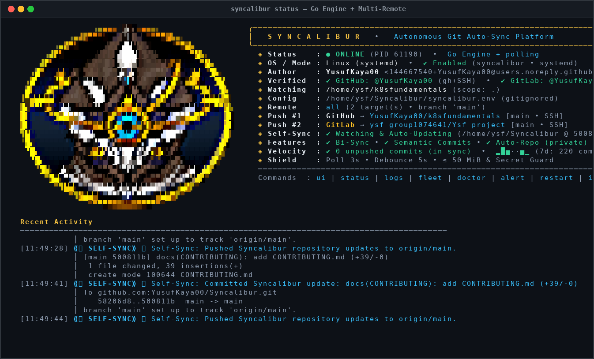
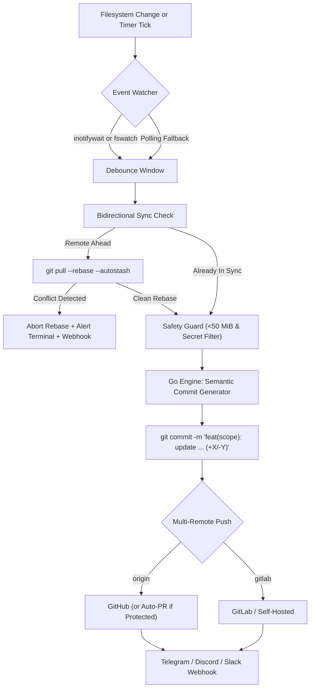

<div align="center">


# Syncalibur

**Hybrid Go + Bash Autonomous Git Multi-Remote Sync Engine, Multi-Repo Fleet Supervisor & Live TUI Cockpit**

[](https://github.com/YusufKaya00/Syncalibur/actions)
[](#cli-command-reference)
[](#architecture--sync-pipeline)
[](#what-is-syncalibur)
[](CONTRIBUTING.md)

*Forge-grade background synchronization for your repositories — powered by a compiled Go core (`syncalibur-engine`) for sub-millisecond TrueColor terminal emblem rendering, Semantic Conventional Commit generation, concurrent Multi-Repo Fleet orchestration, Telegram & Multi-Channel Webhooks, and an Interactive Live TUI Cockpit.*

</div>

---

## Terminal Preview (`syncalibur status` & `syncalibur ui`)

When you run `syncalibur status`, `syncalibur logs`, or `syncalibur ui`, the native Go engine renders [`assets/syncalibur-logo.png`](assets/syncalibur-logo.png) directly inside your terminal using **24-bit TrueColor ANSI escape sequences** alongside live repository telemetry, verified accounts, and a 7-day commit velocity sparkline:

<div align="center">
  
</div>

---

## One-Liner Quick Install

Anyone can install Syncalibur globally in seconds:

```bash
curl -fsSL https://raw.githubusercontent.com/YusufKaya00/Syncalibur/main/install.sh | bash
```

Or clone manually and watch any local repository:

```bash
git clone https://github.com/YusufKaya00/Syncalibur.git ~/Syncalibur
cd ~/Syncalibur
./syncalibur.sh install /path/to/your/repo
```

Once installed, the global `syncalibur` command is automatically linked into `~/.local/bin/syncalibur` so you can run `syncalibur ui`, `syncalibur status`, `syncalibur fleet`, `syncalibur notify`, or `syncalibur doctor` from any directory.

---

## What is Syncalibur?

### 1. Git Intelligence, Bidirectional Sync, Fleet & Event-Driven Watching
- **Compiled Go Core (`cmd/syncalibur-engine/main.go`):** Zero external Go dependencies (100% Go standard library). Automatically compiled into `bin/syncalibur-engine` on first run or after any self-update.
- **Semantic Conventional Commit Engine:** Instead of generic timestamps, the Go diff analyzer inspects staged changes, detects common directory scopes, classifies commit types (`feat`, `fix`, `docs`, `refactor`, `test`, `build`, `ci`, `chore`), and appends line addition/deletion metrics:
  - `feat(scripts): update syncalibur.sh, main.go (+142/-18)`
  - `docs(README): update README.md (+85/-12)`
  - Optional local **Ollama AI Commit Hook** (`SYNCALIBUR_AI_COMMIT="true"`) with a strict 2-second non-blocking timeout and automatic heuristic fallback.
- **Safe Bidirectional Sync (`--rebase --autostash`):** Periodically fetches from your primary remote (`origin`), detects when remote commits are ahead of local `HEAD`, and safely runs `git pull --rebase --autostash` when the working tree is clean. If a merge conflict is detected, Syncalibur **immediately aborts the rebase** (`git rebase --abort`), leaves your working tree untouched, and pops open a diagnostic terminal window.
- **Protected Branch Auto-PR with Rich Template:** If a target branch (like `main`) is protected with required Pull Request reviews or force-push restrictions, Syncalibur automatically pushes a `sync/auto-*` branch and opens a Pull Request populated with a structured Markdown PR template (diff stats, component checkboxes, and verification checklist).
- **Organic Commit Cadence & Contribution Consistency:** Naturally turns your real day-to-day coding progress into steady, well-scoped semantic commits pushed on time across GitHub and GitLab — keeping your contribution graph consistently active with genuine code changes (never fake or empty commits).
- **Native Filesystem Event Watching (`inotifywait` / `fswatch`):** Zero-CPU event-driven watching when `inotifywait` (Linux) or `fswatch` (macOS) is installed, with automatic fallback to lightweight polling.
- **Multi-Repository Fleet Supervisor (`repos.list`):** Watch 5, 10, or 50 repositories simultaneously! Run `syncalibur fleet scan ~/projects` to auto-discover all Git repositories using concurrent Go goroutines and supervise them in parallel.

### 2. Interactive Live TUI Cockpit, Telegram Bot Alerts & Diagnostics
- **Native `syncalibur` Process Identity (`top` / `htop` / Activity Monitor / Task Manager):** Runs under its own compiled binary process name **`syncalibur`** across Linux, macOS, and Windows so you can inspect exact CPU and RAM usage directly in `top` or `syncalibur status`.
- **Interactive Live TUI Cockpit (`syncalibur ui`):** Full-screen, flicker-free terminal control center built in Go using raw terminal mode and alternate screen buffering. Features the high-definition TrueColor emblem, live daemon telemetry, 7-day commit velocity sparkline (`▂█▅··▅▁`), remote matrix, live log stream, and single-keystroke hotkeys:
  - `[p]` Pause / Resume Auto-Sync
  - `[s]` Force Immediate Commit & Push
  - `[b]` Force Bidirectional Pull (`--rebase`)
  - `[u]` Check & Apply Syncalibur Self-Update
  - `[d]` Run 10-Point System Doctor
  - `[q]` Quit TUI cleanly
- **Telegram Bot & Multi-Channel Webhooks (`Telegram`, `Discord`, `Slack`, `Generic JSON`):** Configure `SYNCALIBUR_TELEGRAM_BOT_TOKEN` & `SYNCALIBUR_TELEGRAM_CHAT_ID` (or `SYNCALIBUR_WEBHOOK_URL`) in `syncalibur.env` to receive instant rich notifications on push failures, rebase conflicts, self-updates, or every sync, and test anytime with `syncalibur notify` (`syncalibur telegram-test`).
- **10-Point `syncalibur doctor` Diagnostic Suite:** Verifies Git identity, Go engine binary health, filesystem watcher availability, SSH connectivity (`github.com` / `gitlab.com`), `gh` / `glab` CLI authentication, OS background service registration, and remote push permissions.

---

## Architecture & Sync Pipeline



```text
  ┌────────────────────────────────────────────────────────────────────────────────────────┐
  │                       S Y N C A L I B U R   E X E C U T I O N   F L O W                │
  └────────────────────────────────────────────────────────────────────────────────────────┘

   [1] File Change Detected        ──► inotifywait / fswatch (0% CPU) or 3s Polling Fallback
            │
            ▼
   [2] Bidirectional Rebase Check  ──► Fetches remote; runs 'git pull --rebase --autostash'
            │                          (Auto-aborts & pops open Alert Terminal on conflict)
            ▼
   [3] Pre-Staging Safety Shield   ──► Skips files > 50 MiB & blocks .env / *.pem / *.key / *.tfstate
            │
            ▼
   [4] Go Engine Semantic Commit   ──► Analyzes diff stats -> "feat(scope): update X (+42/-7)"
            │
            ▼
   [5] Multi-Remote Push & Alert   ──► Pushes to GitHub + GitLab -> Dispatches Telegram / Webhook
```

---

## CLI Command Reference

| Command | Description |
| :--- | :--- |
| `syncalibur ui` | Launch the **Interactive Full-Screen Live TUI Cockpit** (`[p]` Pause, `[s]` Sync, `[b]` Pull, `[u]` Update, `[d]` Doctor, `[q]` Quit) |
| `syncalibur install [PATH]` | Auto-detect repo, create missing remote repo if needed, link `~/.local/bin/syncalibur`, and start the OS service |
| `syncalibur status` | Render the TrueColor emblem, 7-day commit sparkline, remote matrix, and recent events |
| `syncalibur logs` | Render the emblem header and stream live color-coded log events (`tail -f`) |
| `syncalibur sync` | Trigger an immediate one-shot bidirectional pull, semantic commit, and multi-remote push |
| `syncalibur pull` | Trigger an immediate safe bidirectional pull (`git pull --rebase --autostash`) |
| `syncalibur pause` / `resume` | Temporarily pause or resume background auto-commits without uninstalling the service |
| `syncalibur notify [MSG]` | Send an instant test notification to your configured **Telegram Bot** (`syncalibur telegram-test`) and Webhook |
| `syncalibur doctor` | Run the 10-point diagnostic health check (Git, Go Engine, inotify, SSH, `gh`/`glab`, remotes) |
| `syncalibur fleet status` | Display a concurrent status table of all repositories in `repos.list` |
| `syncalibur fleet scan [DIR]` | Recursively scan a directory for Git repositories using Go goroutines and append them to `repos.list` |
| `syncalibur fleet start` | Spawn background Syncalibur daemons for every active repository in `repos.list` |
| `syncalibur fleet stop` | Stop all background fleet daemons |
| `syncalibur self-update` | Immediately check Syncalibur's own repository for updates, rebuild the Go engine, and reload |
| `syncalibur alert` | Test the graphical pop-up diagnostic terminal window on your desktop environment |
| `syncalibur uninstall` | Stop the background daemon and remove OS startup registration |

---

## Configuration (`syncalibur.env.example` → `syncalibur.env`)

Your personal `syncalibur.env` and `repos.list` files are **gitignored** so your local paths and webhook tokens are never pushed to GitHub. To customize settings, copy the template:

```bash
cp syncalibur.env.example syncalibur.env
```

```dotenv
# Target Git repository path to watch and auto-sync
SYNCALIBUR_REPO_DIR="/path/to/your/git/repository"

# Push target strategy:
#   "all"    -> Push to ALL configured git remotes (e.g., GitHub + GitLab simultaneously)
#   "origin" -> Push only to origin
SYNCALIBUR_REMOTE="all"

# Commit message style:
#   "semantic" -> Go Engine generates Conventional Commits: feat(scope): update X (+12/-3)
#   "simple"   -> Classic timestamped auto: file1, file2 (YYYY-MM-DD HH:MM:SS)
SYNCALIBUR_COMMIT_STYLE="semantic"

# Optional Local AI Commit Message Generation via Ollama (true / false)
SYNCALIBUR_AI_COMMIT="false"
SYNCALIBUR_OLLAMA_MODEL="qwen2.5-coder:1.5b"

# Safe Bidirectional Sync (auto-pull --rebase --autostash before pushing)
SYNCALIBUR_BIDIRECTIONAL="true"
SYNCALIBUR_PULL_INTERVAL="60"

# Native Filesystem Event Watching (inotifywait / fswatch with polling fallback)
SYNCALIBUR_USE_FS_EVENTS="true"

# Multi-Channel Webhooks (Discord, Slack, Telegram, or Generic JSON)
SYNCALIBUR_WEBHOOK_URL=""
SYNCALIBUR_WEBHOOK_ON_SUCCESS="false"
SYNCALIBUR_TELEGRAM_BOT_TOKEN=""
SYNCALIBUR_TELEGRAM_CHAT_ID=""
```

---

## Telegram Bot & Multi-Channel Webhook Alerts

Syncalibur's Go engine includes a native multi-channel notification dispatcher supporting **Telegram Bot API**, **Discord Embeds**, **Slack Blocks**, and **Generic JSON Webhooks**.

### 1. Configure Telegram Bot Alerts
1. Message [@BotFather](https://t.me/BotFather) on Telegram and run `/newbot` to get your bot token.
2. Obtain your chat or channel ID (for example via `@userinfobot` or `https://api.telegram.org/bot<TOKEN>/getUpdates`).
3. Add your credentials to `syncalibur.env`:

```dotenv
SYNCALIBUR_TELEGRAM_BOT_TOKEN="123456789:ABCdefGHIjklMNOpqrSTUvwxYZ"
SYNCALIBUR_TELEGRAM_CHAT_ID="987654321"
# Set to "true" if you also want notifications on every successful push (default: failures & conflicts only)
SYNCALIBUR_WEBHOOK_ON_SUCCESS="true"
```

### 2. Configure Discord or Slack Webhooks (Optional)
```dotenv
SYNCALIBUR_WEBHOOK_URL="https://discord.com/api/webhooks/..."
```

### 3. Test Your Notification Channel
Verify your Telegram Bot or Webhook configuration at any time from your terminal:

```bash
syncalibur notify "Hello from Syncalibur!"
# or
syncalibur telegram-test
```

---

## Multi-Repository Fleet Mode (`repos.list`)

Want to watch multiple projects at once? Use **Fleet Mode**:

```bash
# Automatically scan a workspace directory and add all Git repositories to repos.list
syncalibur fleet scan ~/workspace

# View real-time parallel status across all repositories in your fleet
syncalibur fleet status

# Start background sync daemons for every repository in repos.list
syncalibur fleet start
```

---

## Open-Source Governance & Pull Request Workflow

To protect all users running Syncalibur's autonomous self-updater, the `main` branch is protected with strict repository governance:
- **Force Pushes & Branch Deletion Disabled:** History on `main` cannot be overwritten.
- **Pull Request & 1 Approval Required:** Direct pushes to `main` from external contributors are blocked; all changes require a Pull Request and **at least 1 approving review** from `@YusufKaya00` (`CODEOWNERS`).
- **Automated CI Verification (`Syncalibur CI`):** Every PR automatically runs Bash syntax verification, `ShellCheck`, `go vet`, native `go build`, engine smoke tests, and secret hygiene checks before merging is allowed.
- **Automated PR Triage (`PR Governance & Auto-Labeler`):** Pull requests are automatically labeled by component (`go-engine`, `shell-daemon`, `documentation`, `ci-cd`) and diff size (`size/S`, `size/M`, `size/L`).

See [CONTRIBUTING.md](CONTRIBUTING.md) for step-by-step instructions on opening a Pull Request.

---

## Repository Structure

```text
Syncalibur/
├── .github/
│   ├── CODEOWNERS                 # Auto-assigns @YusufKaya00 for mandatory PR review
│   ├── pull_request_template.md   # Standardized PR checklist
│   └── workflows/
│       ├── ci.yml                 # Automated Go build, ShellCheck & smoke test CI
│       └── pr-governance.yml      # Automatic PR component & size labeler
├── assets/
│   ├── syncalibur-logo.png        # Official Syncalibur Emblem (rendered in TrueColor ANSI)
│   └── syncalibur-terminal.png    # High-DPI screenshot of `syncalibur status`
├── cmd/
│   └── syncalibur-engine/
│       └── main.go                # Go Core Engine (PNG Renderer, Semantic Commits, Fleet, Webhooks, Live TUI)
├── CONTRIBUTING.md                # Contributor & Pull Request workflow guide
├── go.mod                         # Go module definition (zero external dependencies)
├── install.sh                     # 1-Liner public curl|bash installer
├── syncalibur.sh                  # Cross-platform Service Manager & Daemon Supervisor
├── syncalibur.env.example         # Public configuration template (syncalibur.env is gitignored)
├── repos.list.example             # Multi-repository fleet configuration template
└── README.md                      # Documentation
```

---

## License

MIT License — Free for personal and commercial use.
